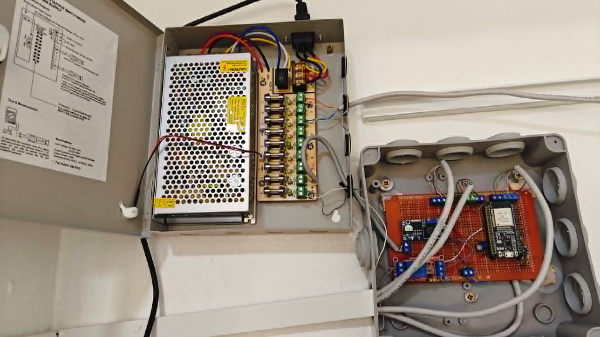
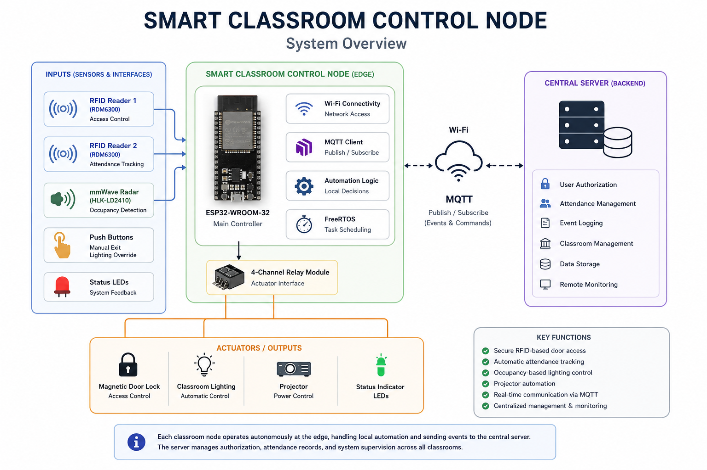
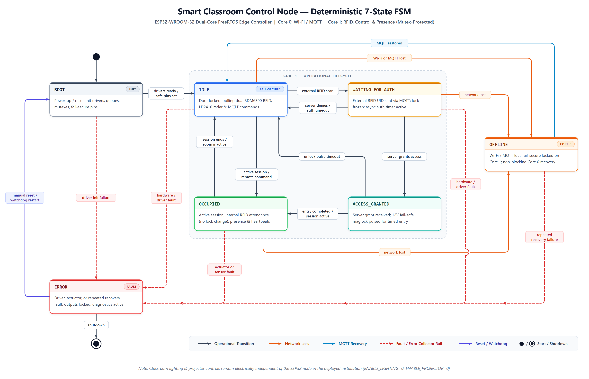

# Smart Classroom Control Node

**An ESP32-based IoT edge node for classroom access control, attendance tracking, and classroom automation through a distributed MQTT architecture.**

 

---

*Installed Smart Classroom Control Node prototype.*

---

> **Public project documentation**
>
> The project's source code is maintained in a separate private repository due to confidentiality and privacy considerations. This repository presents the architecture, hardware design, implementation approach, and engineering decisions behind the project without exposing the private source code.

## Overview

The Smart Classroom Control Node is an embedded system developed as part of a Master's project in Automation and Industrial Computing at Frères Mentouri Constantine 1 University. It is designed to modernize conventional classrooms by combining secure RFID-based access control, automated attendance tracking, mmWave occupancy telemetry, and centralized monitoring.

Each classroom is equipped with an ESP32 controller that interfaces with local sensors and actuators while communicating with a central server over MQTT. The node is responsible for hardware control and event reporting, whereas authorization, attendance management, and long-term data storage are handled by the server. This separation keeps the firmware lightweight, modular, and easier to maintain while allowing multiple classroom nodes to be managed from a single backend.

## Features

- Stateless RFID-based classroom access control using dual RDM6300 UART readers (external access & internal attendance)
- Independent RFID attendance tracking with server-side logging (internal scans never alter lock state)
- Occupancy detection and telemetry using the HLK-LD2410 mmWave radar sensor
- Relay-driven 12 V fail-safe magnetic door lock with timed unlock window and manual exit override
- MQTT/JSON client–server communication with centralized server authorization (ArduinoJson v7)
- Layered PlatformIO C/C++ firmware architecture for modularity and maintainability
- Dual-core FreeRTOS task scheduling (Core 0 networking; Core 1 RFID, control & presence) with mutex protection
- Deterministic 7-state non-blocking operational FSM with asynchronous auth timeouts, offline fail-secure handling, and watchdog recovery
- *Deployment isolation note:* While early prototype revisions and compile-time firmware flags included relay hooks for classroom lighting and projector switching, **classroom lighting and projector controls remained electrically independent of the ESP32 node** in the deployed university installation (standalone PIR lighting / manual switchgear) for electrical safety and EMI isolation.

## System Architecture

The Smart Classroom Control Node follows a distributed architecture in which each classroom is equipped with an independent ESP32-based control node. The node is responsible for interacting with local hardware, while a central server manages authorization, attendance records, and system supervision.

    MQTT over Wi-Fi
    +------------------------+        +------------------------------+
    |     Central Server     |<------>|  Smart Classroom Control Node|
    |------------------------|        |------------------------------|
    | • User Authorization   |        | • ESP32-WROOM-32 (Dual-Core) |
    | • Attendance Database  |        | • 2× RDM6300 UART RFID       |
    | • Event Logging        |        | • HLK-LD2410 mmWave Radar    |
    | • Classroom Management |        | • Relay Stage & Safety Logic |
    +------------------------+        | • Status LEDs & Exit Button  |
                                      +--------------+---------------+
                                                     |
                           +-------------------------+------------------------+
                           |                         |                        |
                   12V Fail-Safe               Status LEDs              Auxiliary Relays
                     Door Lock               & Exit Override        (Disabled in Deployment)*

    *Lighting and projector controls remain electrically independent in the field-deployed classrooms.

The ESP32 acts as a stateless edge controller. It reads sensors, drives the access lock actuator, publishes telemetry and events over MQTT, and reports classroom presence. Decisions requiring centralized data—such as user authorization and attendance management—are handled by the server.

## Hardware Overview

The field-validated prototype is built around an ESP32-WROOM-32 microcontroller and integrates the following hardware components:

| Component | Purpose |
|---|---|
| ESP32-WROOM-32 | Main dual-core controller (FreeRTOS) |
| 2× RDM6300 RFID Readers | External access control & internal attendance tracking (UART1 / UART2) |
| HLK-LD2410 mmWave Radar | Classroom occupancy presence sensing |
| Opto-Isolated Relay Module | Drives 12 V fail-safe magnetic lock (auxiliary lighting/projector channels kept independent in deployment) |
| 12 V Magnetic Lock | Fail-safe classroom door access control with flyback & EMI protection |
| LM2596 Buck Converter | 12 V to 5 V power regulation |
| Push Button | Manual classroom exit override |
| Status LEDs | Visual access and system state feedback |

## Software Architecture

The firmware follows a layered architecture to separate hardware access, business logic, communication, and system control.

    Application
         │
    System Layer
         │
    ┌────┴──────────────────────┐
    │                           │
    Services              Communication
    │                           │
    Drivers                Wi-Fi / MQTT
    │
    Hardware Abstraction Layer
    │
    ESP32 Hardware

Each layer has a well-defined responsibility, reducing coupling between modules and making the firmware easier to maintain, test, and extend.

### Deterministic 7-State Operational FSM

To prevent undefined actuator behavior across asynchronous RFID scans, MQTT latency, network drops, and hardware faults, node operation follows a deterministic **7-state non-blocking Finite State Machine** (`BOOT`, `IDLE`, `WAITING_FOR_AUTH`, `ACCESS_GRANTED`, `OCCUPIED`, `OFFLINE`, `ERROR`) synchronized with FreeRTOS mutexes (`xMutex_StateMachine`, `xMutex_MQTT`):

*Deterministic 7-state operational model of the Smart Classroom Control Node.*

## Project Structure

    .
    ├── docs/                  # Project documentation
    ├── include/               # Shared headers and configuration
    ├── src/
    │   ├── communication/     # Wi-Fi and MQTT
    │   ├── config/            # System configuration
    │   ├── drivers/           # Hardware drivers
    │   ├── hal/               # Hardware abstraction layer
    │   ├── services/          # Business logic
    │   ├── system/            # State machine and scheduling
    │   └── main.cpp           # Application entry point
    ├── platformio.ini
    └── README.md

The project's source code is maintained in a separate private repository due to confidentiality and privacy considerations. The structure above reflects the organization of the firmware and supporting files used during development.

The project is organized using a layered architecture to separate hardware access, application logic, communication, and system management. This structure simplifies maintenance and allows individual components to evolve independently.

## Project Status

### Functional Prototype

This project was developed as part of a Master's degree in Automation and Industrial Computing and has been field-validated in two university classrooms.

Implemented and deployed features include:

- Stateless RFID-based classroom access control (external RDM6300 reader)
- Independent RFID attendance tracking (internal RDM6300 reader)
- HLK-LD2410 mmWave room-presence sensing & telemetry
- Relay-driven 12 V fail-safe magnetic door lock with flyback/EMI protection
- MQTT/JSON communication with a centralized authorization server
- Dual-core FreeRTOS firmware with mutex-protected shared state
- Deterministic 7-state operational FSM with offline fail-secure & watchdog recovery
- Layered PlatformIO C/C++ software architecture *(lighting & projector controls intentionally kept electrically independent in the deployed rooms)*

The repository will continue to receive documentation improvements and code cleanup over time.

For additional information about the project design and deployment, see the documentation available in the [`docs`](docs/) directory.

## Authors

**Ahmed Amine Boufas** · **Mohamed El Mamoune Fedjekhi**

Master's Degree in Automation and Industrial Computing  
Frères Mentouri Constantine 1 University  
Academic Year: 2025–2026

## License

This project is released under a custom license. See the [`LICENSE`](LICENSE) file for details.
